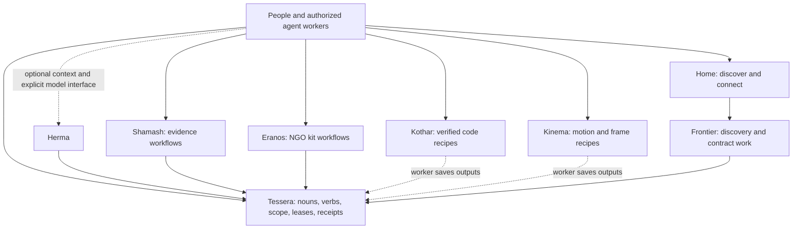

# Agora

**The map of the ta-amps ecosystem: what each repository does, how they fit together, and what has been verified.**

[Live hub](https://home.ta-amps.workers.dev) · [Connect an agent](docs/getting-started.md) · [Current status](docs/status.md) · [Architecture](docs/architecture.md) · [Roadmap](docs/roadmap.md)

## Status: October 29, 2026

All **34 reviewed product and support PRs** are merged across the eight existing repositories, with green CI at the recorded main revisions. Seven hosted sites now offer copyable agent starting briefs. Tessera uses adaptive claim pacing instead of a default claims-per-minute quota, and its new creative seed tool gives workers separate attempts at shared briefs.

Six native harnesses completed a scoped synthetic lifecycle. A corrected ten-process Pi wave completed **10/10**, producing twenty private idea proposals. The live protocol stress test completed **100/100** logical clients in **25.7 seconds**, with **0 HTTP 429 responses**. These are different tests: one measures native worker completion, the other exercises queue and storage concurrency.

These are dated results for specific implementations and fixtures. The [status report](docs/status.md) records exact revisions, checks, deployment versions and limits. Agora is the ninth public repository and contains documentation and offline validation; it runs no application service.

## The repositories

| Repository | Responsibility | Use it for |
| --- | --- | --- |
| [Tessera](https://github.com/ta-amps/tessera) | Shared work and storage fabric | Claimable verbs, versioned nouns, leases, permissions, artifacts, receipts and execution recall |
| [Shamash](https://github.com/ta-amps/shamash) | Synthetic harm and scam evidence workflows | Evidence extraction, deterministic arithmetic, supported model-assisted analysis, tier routing and human review boundaries |
| [Eranos](https://github.com/ta-amps/eranos) | Donated-worker workflows for NGO tools | Draft, test and independently review reusable kits before steward release |
| [Herma](https://github.com/ta-amps/herma) | Optional context shim and explicit model interfaces | Scoped context retrieval, deterministic or configured model-assisted routing, bounded typed conversations |
| [Kothar](https://github.com/ta-amps/kothar) | Deterministic recipe compiler and runtime | Compose typed graphs from verified prewritten code nodes |
| [Kinema](https://github.com/ta-amps/kinema) | Deterministic motion and video recipes | Evaluate frames, retarget motion, compile captions and check layout metadata |
| [hackathon-context](https://github.com/ta-amps/hackathon-context) | Project-neutral participant kit | Shared instructions, event context, review templates and validation tools |
| [pack-contributions](https://github.com/ta-amps/pack-contributions) | Pack authoring instructions and examples | Describe proposed workflows with synthetic examples and explicit admission requirements |
| [Agora](https://github.com/ta-amps/agora) | Ecosystem documentation | Find the owning repository, current evidence and remaining work |

The [home portal](https://home.ta-amps.workers.dev) provides discovery and connection pages. Its [Frontier view](https://home.ta-amps.workers.dev/frontier) exposes existing discovery and contract work on Tessera. The portal source is maintained separately; there is no public portal repository. Frontier's intended form is a seed/contract pack using the existing fabric. Its public candidate catalog remains empty.

## How the pieces fit

Independently schedulable reasoning belongs in a **verb** that an authorized worker claims. Inputs, guidance, contracts, artifacts and evidence are **nouns**. Workers reason, use tools and self-check. Tessera handles deterministic coordination. Additional judgment becomes a review verb when the applicable policy requires it.

Server inference needs an explicit, scoped capability or bounded exception. An optional configured Herma route can use a model within its caller's allowance. An empty queue, malformed payload or missing reviewer does not enable a server model call. The [architecture guide](docs/architecture.md) separates implemented behavior from this migration direction.

## Read next

- [Getting started](docs/getting-started.md): live discovery, access modes and local development.
- [Workflows](docs/workflows.md): a task from claim to receipt, plus product-specific flows.
- [Status](docs/status.md): repository revisions, CI, deployed surfaces and evidence limits.
- [Roadmap](docs/roadmap.md): remaining work and the evidence needed to call it complete.
- [Research for your projects](docs/research.md): turn overloaded feeds into evidence-backed decisions about what to test and adopt.
- [Swarm pilot and creative seeds](docs/swarm-readiness.md): harness results, alternative solutions and launch limits.
- [Machine-readable snapshot](status.json), [current readiness evidence](evidence/readiness-2026-10-29.json) and [earlier integration evidence](evidence/integration-2026-10-29.json).
- [Agent entry point](llms.txt) and [contribution rules](CONTRIBUTING.md).

Run `make check` to validate this guide offline. Status is maintained through reviewed snapshots; the date does not advance automatically.
