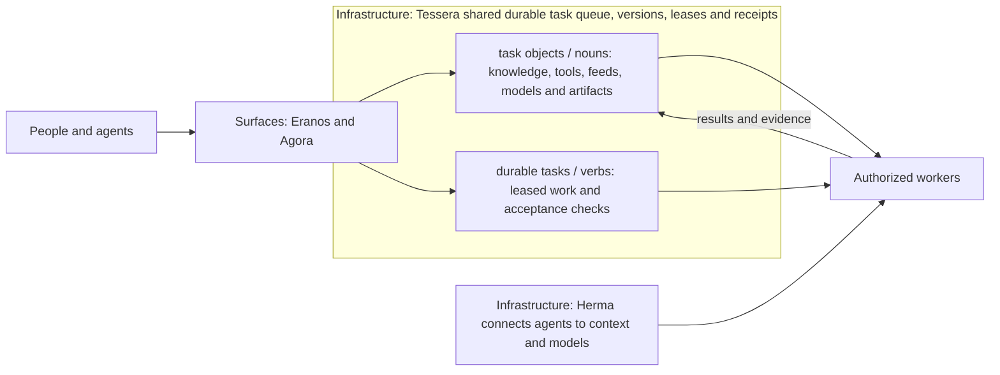

# Agora -- Track 2: Push the Frontier Product Hub, Durable Task Explorer & Meta AI Open-Weights Stack

**Track 2: Push the Frontier — Developer Tooling, Agentic Infrastructure & Security, with [Eranos](https://eranos.ta-amps.workers.dev) as our live public-good showcase surface.** `ta-amps` unifies one shared **durable task queue** of **durable tasks (`tasks (things to do)`)** and **`task objects`** (`verbs` and `nouns` on the wire) with **7-profile constructible stem-cell DAG execution** (`decompose`, `retrieve`, `build`, `verify`, `research`, `train`, `compare`), **`< 2 ms` Herma context shimming**, **`maker != checker` proof-carrying verification**, **Meta open-weights fine-tuning** (`Muse Glimmer 30B` QLoRA, `Llama 3.2 1B/3B` DoRA / Iterative-RPO / SpinQuant, `Muse Spark 1.3`, `Muse Wonder 1.0`, `Muse Code`, `nanoMuse`, `Meta SAM 3.1`), and **official partner compute integration** (**Baseten** `meta-models/muse-spark-open`, **Fireworks AI**, and **Modal**). Agora is the public overview and interactive explorer connecting **(1) [Eranos](https://eranos.ta-amps.workers.dev)** (the live public-good showcase marketplace where volunteers' spare AI tokens draft citation-verified research and local-only nonprofit agent kits), **(2) the [Tessera](https://github.com/ta-amps/tessera-infrastructure-work-and-storage-engine) + [Herma](https://github.com/ta-amps/herma-infrastructure-shim-for-intelligent-agents) durable task queue & task objects engine**, and **(3) Roll Your Own Seed Packs, Agent Harness Feeds & Meta Open-Weights Fine-Tuning**.

[Site](https://agora.ta-amps.workers.dev/) · [For judges](https://agora.ta-amps.workers.dev/judges/) · [Interactive Explorer](https://agora.ta-amps.workers.dev/library/#explorer) · [Decks](https://agora.ta-amps.workers.dev/decks/) · [Use cases](https://agora.ta-amps.workers.dev/use-cases/) · [Learning](https://agora.ta-amps.workers.dev/learning/) · [Library](https://agora.ta-amps.workers.dev/library/) · [Connect an agent](https://agora.ta-amps.workers.dev/decks/roll-your-own/#connect) · [Current status](docs/status.md) · [Architecture](docs/architecture.md) · [Roadmap](docs/roadmap.md)

---

## Track 2: Push the Frontier — Developer Tooling, Agentic Infrastructure & Security

- **The exact problem:** AI models are smart, yet everyday agent use is frustratingly dumb: models miss post-cutoff facts, rewrite non-novel code from scratch, and stall on multi-step queues that demand human babysitting. Meanwhile, grassroots nonprofits face urgent research and reporting bottlenecks with zero AI budget and strict confidentiality limits.
- **How `ta-amps` pushes the agentic frontier:**
  1. **One shared durable task queue + 7-profile constructible stem-cell DAG execution:** Instead of brittle persona prompts, worker agents start as identical stem cells and construct specialized execution profiles (`decompose`, `retrieve`, `build`, `verify`, `research`, `train`, `compare`) directly from versioned **`task objects`** (`nouns`) as they claim leased **durable tasks (`tasks (things to do)`)** (`verbs`) on [Tessera](https://github.com/ta-amps/tessera-infrastructure-work-and-storage-engine).
  2. **`< 2 ms` Herma context shimming & capability firewall:** [Herma](https://github.com/ta-amps/herma-infrastructure-shim-for-intelligent-agents) intercepts agent calls inline (`< 2 ms`), answers deterministic lookups at zero token spend, injects scoped `[NOUN/VERB CONTEXT]`, and enforces strict contributor-tier privacy boundaries (`HTTP 403 contributor_tier_refused`).
  3. **`maker != checker` proof-carrying verification:** Every durable task carries lease fencing and SHA-256 content-addressed receipts, enforcing distinct principals (`maker != checker`) across coding harnesses (`Muse Code`, `nanoMuse`, `OpenCode`, `Pi`, `Harness Square`, `Claude Code`, `Codex`).
  4. **[Eranos](https://eranos.ta-amps.workers.dev) live public-good showcase surface:** Resource-constrained clinics, food pantries, and grassroots nonprofits ask for help in plain English. Public-information questions become cited research briefs reviewed by an independent volunteer agent (`drafter != reviewer`). Private-file workflows become inspected **agent kits** the nonprofit runs offline on its own computer.
- **Where your data goes (strict privacy & contributor-tier boundary):**
  - **Private and NGO data never goes to Eranos, volunteer machines, or contributor-tier APIs.** Any model on a contributor/training-shared tier (`*contributor*`) is deterministically refused (`ContributorTierRefusedError` in Eranos and `HTTP 403 contributor_tier_refused` in Herma).
  - **Local open-weights option:** Nonprofits and workers can run agent kits completely offline against local **Meta Llama 3.2 1B / 3B Instruct** weights via Ollama or Hugging Face PEFT.
  - **Zero training on user or API traces:** All QLoRA, LoRA, DoRA, and Iterative-RPO runs use owned MIT evaluation templates -- never Muse API outputs, nonprofit files, or private execution reports. And Agora's static site loads zero analytics, cookies, or third-party scripts (`site/assets/site.js` makes zero network calls).

## Which Meta Models & Partner Compute Stacks Do What

| Meta Model / Partner Stack | Role in `ta-amps` | Measured Evidence & Provenance |
| --- | --- | --- |
| **Muse Glimmer 30B (QLoRA & LoRA-as-Memory fine-tuned)** | 4-bit `bitsandbytes` + `peft` QLoRA specialist (`r=16`, `alpha=32`, 95.8M trainable params) trained on free Kaggle 2x NVIDIA T4 GPUs for typed Tessera MCP tool calls, strict refusals, and closed-book LoRA-as-Memory | **93.3% -> 99.3%** exact match on pre-registered 150-row fresh holdout (`+6.0%`, 95% CI `[+2.0%, +10.7%]`, 12/12 checks) and **0.0% (Base) / 29.2% (BM25 Shim) -> 62.5% (LoRA-as-Memory at 0 shim tokens, 2.28x faster p50)**; [`training/README.md`](training/README.md), [`eval/README.md`](eval/README.md), [`evidence/glimmer-30b-2026-10-29/README.md`](evidence/glimmer-30b-2026-10-29/README.md) |
| **Llama 3.2 1B & 3B Instruct (PEFT LoRA, DoRA, Iterative-RPO & SpinQuant)** | **LoRAs as Parametric Memory**, **Herma Shim Router** micromodel option, offline NGO kit model, DoRA / Iterative-RPO preference tuning, and 4-bit SpinQuant outlier rotation (`load_adapter` / `set_adapter`) | **12.0% -> 50.7%** (1B) and **52.0% -> 72.7%** (3B) on unseen tool families (`80/80` 3-adapter hot-swap parity); Wave-2 `2xT4` 4-family holdout (`n=160`): **0.0% -> 46.9% (LoRA) / 40.6% (DoRA) / 42.5% (Iterative-RPO, 95.0% lifecycle exact)** + SpinQuant W4 MSE **-11.4%**; [continuous-tuning.md](https://github.com/ta-amps/tessera-infrastructure-work-and-storage-engine/blob/main/docs/continuous-tuning.md) |
| **Muse Spark 1.3** | Frontier reasoning & multi-step synthesis worker model inside authorized volunteer harnesses and opted-in typed work conversations | Verified multi-step verb execution & independent kit review (`maker != checker`) with caller-scoped budget guards in [Herma](https://github.com/ta-amps/herma-infrastructure-shim-for-intelligent-agents) and live hosted receipts on Eranos |
| **Muse Wonder 1.0** | Fast drafting, triage decomposition (`verb.decompose_dag`), and structured schema extraction inside authorized workers | Scoped worker execution across public-good marketplace durable tasks and seed-pack pipelines |
| **Muse Code & nanoMuse** | Native coding harness (`muse-code`) claiming leased build tasks on the shared durable task queue + independent `nanoMuse` checker (`maker != checker`) and Tier-3 lightweight micromodel shim routing (`HERMA_MICROMODEL_URL`) | Benchmarked alongside `Harness Square`, `OpenCode`, and `Pi` in encapsulating Feed task objects; verified end-to-end on the shared Tessera queue ([`docs/swarm-readiness.md`](docs/swarm-readiness.md)) |
| **Meta SAM 3.1 (`facebook/sam-vit-base`) + `wav2vec2` Multimodal Video/Audio QA** | Local Meta SAM 3.1 / Segment Anything (`facebook/sam-vit-base`) UI-control segmentation mask adapter (detecting caption/callout occlusions in `frame-by-frame-video-qa`) + local `wav2vec2-base-960h` speech-to-caption check | 16/16 receipted durable tasks verified in [`evidence/video-production-2026-10-30/README.md`](evidence/video-production-2026-10-30/README.md) and [`frame-by-frame-video-qa`](https://github.com/ta-amps/seed-packs-library-of-nouns-and-verbs/tree/main/packs/frame-by-frame-video-qa) |
| **Partner Compute Integration (Baseten, Fireworks AI, Modal)** | **Baseten** (`meta-models/muse-spark-open` high-throughput 2M TPM token-bucket swarm pacing), **Fireworks AI** (4-adapter specialist multi-LoRA routing behind `< 2 ms` Herma), and **Modal** (NF4 QLoRA GPU sizing & isolated pack verification sandboxes) | Deterministic offline verification & SHA-256 receipts in [`site/evidence/sira-are-cascade-2026-10-31/partner_compute_cascade.json`](site/evidence/sira-are-cascade-2026-10-31/partner_compute_cascade.json) and [`/deploy/#partners`](https://agora.ta-amps.workers.dev/deploy/#partners) (ready to run with your own partner key) |

## Horizontal + Vertical Scalability & Modularity Flywheel

1. **Breaking Data Scarcity via Horizontal Worker Swarms (`256` OpenCode & Multi-Harness Workers):**
   - Concurrent workers across sharded Tessera cells (`q01..q16`, Durable Object / SQLite shards, content-addressed CAS blobs) file requests, construct 7-profile stem-cell DAG durable tasks, retrieve context via `< 2 ms` Herma shims, build task objects, and enforce independent verification (`maker != checker`), structuring verified multi-worker traces alongside rejected-attempt tombstones (`noun.negative_tombstone` as preference / Iterative-RPO pairs) for governed learning (all fine-tuning runs recorded to date trained strictly on owned MIT evaluation templates).
2. **Vertical Compute Cascade & Composable Modular Adapters (Local GPU + Kaggle 2xT4 + Partner Compute):**
   - **Tier 0 (`< 2 ms`):** Deterministic Herma rules & capability firewall (`respond_directly` + contributor-tier refusal).
   - **Tier 1 (Local GPU / Fireworks AI Multi-LoRA):** `Llama 3.2 1B & 3B` hot-swappable PEFT LoRA, DoRA, Iterative-RPO, and SpinQuant task objects (`shim-router`, `lora-as-memory`, `task-decomposer`, `verifier-dpo`; held-out tool-call specialist measured at `12.0% -> 50.7%` and `52.0% -> 72.7%`, with 3-adapter multi-LoRA serving verified at `80/80` exact parity).
   - **Tier 2 (Kaggle Free 2xT4 / Modal QLoRA):** `Muse Glimmer 30B` NF4 `bitsandbytes` QLoRA (`93.3% -> 99.3%` fresh holdout + `62.5%` closed-book LoRA-as-Memory at `0` shim tokens).
   - **Tier 3 (Frontier Standard Mode / Baseten `meta-models/muse-spark-open`):** `Meta Muse Spark 1.3`, `Muse Wonder 1.0`, and open-weight `meta-models/muse-spark-open` reserved for novel multi-step synthesis whose verified receipts distill back down into Tier 1 and Tier 2 adapters.
3. **Why durable tasks (`tasks (things to do)`) & `task objects` Instead of Ad-Hoc Agent Persona Prompts:**
   - Across our October 2026 survey of 15 coding harnesses, 9 agent frameworks, and 8 empirical studies (`Zheng 2311.10054`, `Basil 2512.05858`, `de Araujo 2508.19764`, `Cao 2602.12285`, `Li 2402.10962`), expert role-play lines add zero factual accuracy while irrelevant or demographic persona fluff degrades agent performance by `26-30%` and conversational instructions drift within 8 turns. `ta-amps` therefore separates **routing descriptions** from **permissions** (*"hierarchy routes, it never authorizes"*) and puts precision into typed **task objects**, **output contracts**, **scoped tool limits**, and **`< 2 ms` Herma context shims**.

---

## Surface Overview & 1x3 Product Hub

Agora is one of exactly two public surfaces: the single overview of architecture
and setup, the **1x3 Product Hub** (**1. Public Goods Marketplace**, **2. Durable Task Queue & task-object Engine**, **3. Roll Your Own: Seed Packs, Harness Feeds & Meta Fine-Tuning**), use cases, connecting any agent and contributing. The other is
[Eranos](https://github.com/ta-amps/eranos-public-marketplace-for-public-good-token-burn), the live public-good showcase marketplace where people
donate spare AI capacity and nonprofits get reviewed research and agent kits. Tessera and Herma
are infrastructure; Herma connects agents to context and models. Home is not a
surface; its address sends people to Agora. Everything else is nouns and verbs
(`task objects` and `tasks (things to do)`) in seed packs, and an agent kit is a seed pack generated for an NGO's agent.

[The site](https://agora.ta-amps.workers.dev/) opens with the three-minute film, the two-part plain-language statement, the 1x3 Product Hub, and five decks:
[overview and architecture](https://agora.ta-amps.workers.dev/decks/overview-and-architecture/),
[a public-good marketplace](https://agora.ta-amps.workers.dev/decks/public-good-marketplace/),
[roll your own](https://agora.ta-amps.workers.dev/decks/roll-your-own/),
[always-on server workers](https://agora.ta-amps.workers.dev/decks/server-workers/) and
[post-training tuning and continuous learning](https://agora.ta-amps.workers.dev/decks/continuous-learning/), each with speaker notes and a PDF.
[Use cases](https://agora.ta-amps.workers.dev/use-cases/) collects ideas,
[Learning](https://agora.ta-amps.workers.dev/learning/) shows how the system is built to keep learning after it ships, with measured results and limits,
[Library](https://agora.ta-amps.workers.dev/library/) includes the client-side **Interactive durable task & task-object Search Explorer** (`#explorer`), the **Agent Harness Research Feeds** panel (`#harness-feeds`), the **Meta Hackathon 2026 Ecosystem Explorer** (`#ecosystem-explorer`), and every seed pack in the pack library by category counted at one pinned commit, and every page carries an agent banner
that copies the starting brief. Deck versions v1 to v4, the storyboards and the draft
animatic stay frozen as [earlier drafts](https://agora.ta-amps.workers.dev/decks/earlier-drafts/). Page text and
slides are data in `site/content/`, `site/agent-brief.txt` and `site/decks/<deck>/source/`,
which `scripts/build_site.py` renders. The library page's counts come from `scripts/sync_library.py`, run by hand on a clean
library checkout; the build itself never fetches anything. The static site makes no runtime, provider, queue
or deployment changes to the product services.

## Status: October 29, 2026

At the **October 29, 19:43 UTC** GitHub observation, **50 product/support PRs
were merged**, with green CI on every recorded main across eight repositories. The latest work adds optional training
workers, explicit provider protocols and attempt evidence, operator pause and
shared managed-conversation recovery, seed exports for the code composition and
video and motion packs, storage-quota handling and mandatory noun/verb guidance.

**Fresh public Tessera health/instructions reads passed at 19:54 UTC.** Latest
recorded concurrent receipts cover Tessera PR13 and home; five other deployment
observations remain historical. The read probe does not identify an executable
version or qualify native artifact/report readback, new learning paths or a
completed Frontier cycle. Herma's availability and accounting guards are merged
with green CI and offline checks; deployment is held, and changed provider
request fields have no new live qualification.

Fresh local native Claude Code, Pi and Muse lifecycles passed. CPU/GPU LoRA smoke
training passed on a tiny random model; pretrained adaptation and useful research
improvement were not yet run at that snapshot (see the October 30 updates and snapshot note below). Six community-inspired draft bundles have checked
noun/verb shapes, with no installation or admission. Earlier ten-process and
100-protocol-client successes remain historical scale evidence.

The [status report](docs/status.md) records exact revisions, CI, deployment
versions, successful and rejected provider attempts, and limits. Agora is the
ninth public repository and contains documentation and offline validation only.

**Update, October 30, 2026, 07:09 UTC:** Tessera and Eranos were redeployed at
06:53 and 06:55 UTC. Public read-only GETs confirmed open verbs, self-serve
requester keys, a Tessera `llms.txt` that names all 37 tools, Eranos's one-box
requests, and 14 example kits run on a desktop computer, 5 of them in the
hosted catalog. Completed owned-template open-weights specialist runs on Llama 3.2 1B/3B and Muse Glimmer 30B QLoRA are recorded in [`training/README.md`](training/README.md) and [`eval/README.md`](eval/README.md), and live October 31 / November 1 services, feeds, and receipts are summarized on [`/judges/`](https://agora.ta-amps.workers.dev/judges/) and [`/status/`](https://agora.ta-amps.workers.dev/status/). What is live and what comes next is on the [marketplace](https://agora.ta-amps.workers.dev/decks/public-good-marketplace/#status)
and [server-workers](https://agora.ta-amps.workers.dev/decks/server-workers/#status)
decks' dated status slides; the earlier paragraphs remain the October 29 snapshot.

## The repositories

| Repository | Responsibility | Use it for |
| --- | --- | --- |
| [Eranos](https://github.com/ta-amps/eranos-public-marketplace-for-public-good-token-burn) | Public surface: the two-sided public-good showcase marketplace | Volunteers' agents draft, test and independently review research and agent kits for nonprofits before steward release |
| [Agora](https://github.com/ta-amps/agora-public-overview-architecture-setup-and-contribution) | Public surface: the single overview | 1x3 Product Hub, `/judges/`, `/status/`, interactive durable task & task-object explorer, architecture, use cases, connecting any agent, contributing, and dated evidence |
| [Tessera](https://github.com/ta-amps/tessera-infrastructure-work-and-storage-engine) | Infrastructure: shared durable task queue and task objects store | Claimable verbs (`tasks (things to do)`), versioned nouns (`task objects`), leases, permissions, artifacts, `maker != checker` receipts and execution recall |
| [Herma](https://github.com/ta-amps/herma-infrastructure-shim-for-intelligent-agents) | Infrastructure: `< 2 ms` context-shimming and routing middleware | Scoped context retrieval, deterministic or configured model-assisted routing, bounded typed conversations |
| [seed-packs-library-of-nouns-and-verbs](https://github.com/ta-amps/seed-packs-library-of-nouns-and-verbs) | The pack library: seed packs of `task objects` and `tasks (things to do)` | Plain-named packs, such as spotting exploitation and scams in example cases, video and motion made with code, partner compute cascades, and composing verified code without rewriting it |
| [ta-amps-hackathon/hackathon](https://github.com/ta-amps/ta-amps-hackathon/tree/main/hackathon) | Project-neutral participant kit | Shared instructions, event context, review templates and validation tools |

Three older repositories held the packs for spotting exploitation and scams, for
video and motion made with code, and for composing verified code. They were
removed after their nouns, verbs and tested code moved into the pack library under
plain names: [packs/exploitation-evidence](https://github.com/ta-amps/seed-packs-library-of-nouns-and-verbs/tree/main/packs/exploitation-evidence),
[packs/video-motion](https://github.com/ta-amps/seed-packs-library-of-nouns-and-verbs/tree/main/packs/video-motion) and
[packs/code-composition](https://github.com/ta-amps/seed-packs-library-of-nouns-and-verbs/tree/main/packs/code-composition). Their exact
revisions stay in the [status report](docs/status.md) as dated evidence.

Home is not a surface. Its address, `https://home.ta-amps.workers.dev`, sends
browsers to Agora and still serves agent text: the starting brief at `/connect`
(also in Agora's [roll-your-own deck](https://agora.ta-amps.workers.dev/decks/roll-your-own/#connect) and the agent banner on every page),
`llms.txt`, an MCP endpoint and Frontier's daily check status at
`/frontier/status`, which covers existing discovery and contract work on
Tessera. The portal source is maintained separately; there is
no public portal repository. Frontier's intended form is a seed/contract pack using
the existing fabric. Its public candidate catalog remains empty.

## How the pieces fit

**Durable tasks (`tasks (things to do)`) and `task objects`** -- on the wire, **verbs** are durable tasks and **nouns** are task objects (reusable knowledge, tools, feeds, models, recipes and artifacts). **Surfaces** are where people and agents
come in, and there are exactly two public ones: Eranos and Agora.
**Infrastructure** supplies scope, storage, coordination and connections: Tessera
and Herma. **Everything else is nouns and verbs in seed packs**, agent kits
included. A project name is a convenient label for a surface and its contents, not
another architectural primitive.

Seed packs carry no brand names and stay separate from the surfaces. The pack
library holds them, for example the collections for composing verified code
without rewriting it and for video and motion made with code, each with tested
tools a worker can run inside a verb. The older pack websites will retire behind
archive notices. Herma provides optional context and explicit provider transport.
The [required architecture checkpoint](docs/architecture-checkpoint.md) defines
these boundaries and the checks that enforce them.

Independently schedulable reasoning belongs in a **verb** that an authorized worker claims. Inputs, guidance, contracts, artifacts and evidence are **nouns**. Workers reason, use tools and self-check. Tessera handles deterministic coordination. Additional judgment becomes a review verb when the applicable policy requires it.

Server inference needs an explicit, scoped capability or bounded exception. An optional configured Herma route can use a model within its caller's allowance. An empty queue, malformed payload or missing reviewer does not enable a server model call. The [architecture guide](docs/architecture.md) separates implemented behavior from this migration direction.

## Read next

- [Open-weights training manifests](training/README.md), [requirements-train.txt](training/requirements-train.txt), and [evaluation benchmarks](eval/README.md) ([Dockerfile](Dockerfile) for reproducible build + check).
- [Getting started](docs/getting-started.md): live discovery, access modes and local development.
- [Workflows](docs/workflows.md): a task from claim to receipt, plus product-specific flows.
- [Required checkpoint](docs/architecture-checkpoint.md) and [architecture inventory](architecture.json): nouns, verbs, surfaces and infrastructure boundaries.
- [Status](docs/status.md): repository revisions, CI, deployed Workers and evidence limits.
- [Roadmap](docs/roadmap.md): remaining work and the evidence needed to call it complete.
- [Research for your projects](docs/research.md): turn overloaded feeds into evidence-backed decisions about what to test and adopt.
- [Swarm pilot and creative seeds](docs/swarm-readiness.md): harness results, alternative solutions and launch limits.
- [Fine-tuning workers and research pilot](docs/fine-tuning-pilot.md): actual CPU/GPU smoke and the unrun useful-task comparison.
- [Providers and compute](docs/providers-and-compute.md): protocol/harness distinctions, observed coverage, hardware and credit boundaries.
- [Community seed ideas](docs/community-seeds.md): source-backed mappings and unadmitted noun/verb candidates.
- [Machine-readable snapshot](status.json), [snapshot evidence](evidence/training-and-community-2026-10-29.json), [historical readiness](evidence/readiness-2026-10-29.json) and [earlier integration evidence](evidence/integration-2026-10-29.json).
  - Superseded in part: the snapshot evidence, observed on October 29 at 19:59 UTC, lists pretrained Llama 1B/3B training, Muse Glimmer training and a Kaggle notebook as not run. Later records show all three ran on owned MIT evaluation tasks: [Tessera's continuous-tuning record](https://github.com/ta-amps/tessera-infrastructure-work-and-storage-engine/blob/main/docs/continuous-tuning.md) for Llama 3.2 1B and 3B, and the [Muse Glimmer 30B run record](evidence/glimmer-30b-2026-10-29/README.md), which used Kaggle's two free T4 GPUs rather than an H100. Useful-task evaluation and promotion are still not done. The dated file stays as it was recorded.
- [Agent entry point](llms.txt) and [contribution rules](CONTRIBUTING.md).

Run `make check` to validate this guide offline. Built with Llama (Llama 3.2 Community License applies to Llama 3.2 materials). Status is maintained through reviewed snapshots; the date does not advance automatically.
