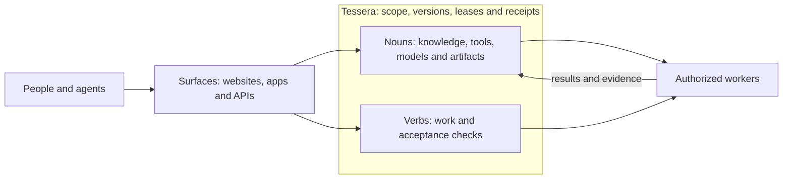

# Agora

**Nouns, verbs, surfaces and infrastructure: the map of what ta-amps does, how its parts fit together, and what has been verified.**

[Live hub](https://home.ta-amps.workers.dev) · [Connect an agent](docs/getting-started.md) · [Current status](docs/status.md) · [Architecture](docs/architecture.md) · [Roadmap](docs/roadmap.md)

[Versioned draft decks](https://ta-amps.github.io/agora/) are available online,
with editable PowerPoint and PDF downloads. The original v1 and qualified v2
remain separately labeled review drafts. The static presentation surface makes
no runtime, provider, queue or deployment changes to the product services.

## Status: October 29, 2026

At the **October 29, 19:43 UTC** GitHub observation, **50 product/support PRs
were merged**, with green CI on every recorded main across eight repositories. The latest work adds optional training
workers, explicit provider protocols and attempt evidence, operator pause and
shared managed-conversation recovery, Kothar/Kinema seed exports, storage-quota
handling and mandatory noun/verb guidance.

**Fresh public Tessera health/instructions reads passed at 19:54 UTC.** Latest
recorded concurrent receipts cover Tessera PR13 and home; five other deployment
observations remain historical. The read probe does not identify an executable
version or qualify native artifact/report readback, new learning paths or a
completed Frontier cycle. Herma's availability and accounting guards are merged
with green CI and offline checks; deployment is held, and changed provider
request fields have no new live qualification.

Fresh local native Claude Code, Pi and Muse lifecycles passed. CPU/GPU LoRA smoke
training passed on a tiny random model; pretrained adaptation and useful research
improvement remain unverified. Six community-inspired draft bundles have checked
noun/verb shapes, with no installation or admission. Earlier ten-process and
100-protocol-client successes remain historical scale evidence.

The [status report](docs/status.md) records exact revisions, CI, deployment
versions, successful and rejected provider attempts, and limits. Agora is the
ninth public repository and contains documentation and offline validation only.

## The repositories

| Repository | Responsibility | Use it for |
| --- | --- | --- |
| [Tessera](https://github.com/ta-amps/tessera) | Shared work and storage fabric | Claimable verbs, versioned nouns, leases, permissions, artifacts, receipts and execution recall |
| [Shamash](https://github.com/ta-amps/shamash) | Synthetic harm and scam evidence workflows | Evidence extraction, deterministic arithmetic, supported model-assisted analysis, tier routing and human review boundaries |
| [Eranos](https://github.com/ta-amps/eranos) | Donated-worker workflows for NGO tools | Draft, test and independently review reusable kits before steward release |
| [Herma](https://github.com/ta-amps/herma) | Optional context shim and explicit model interfaces | Scoped context retrieval, deterministic or configured model-assisted routing, bounded typed conversations |
| [Kothar](https://github.com/ta-amps/kothar) | Code and recipe seed pack with compiler/runtime tools | Reuse verified code-node nouns; compose, execute and verify recipes through verbs |
| [Kinema](https://github.com/ta-amps/kinema) | Motion seed pack with deterministic execution tools | Reuse scene, motion and caption nouns; evaluate, retarget and review through verbs |
| [hackathon-context](https://github.com/ta-amps/hackathon-context) | Project-neutral participant kit | Shared instructions, event context, review templates and validation tools |
| [pack-contributions](https://github.com/ta-amps/pack-contributions) | Pack authoring instructions and examples | Describe proposed workflows with synthetic examples and explicit admission requirements |
| [Agora](https://github.com/ta-amps/agora) | Ecosystem documentation | Find the owning repository, current evidence and remaining work |

The [home portal](https://home.ta-amps.workers.dev) provides discovery and connection pages. Its [Frontier view](https://home.ta-amps.workers.dev/frontier) exposes existing discovery and contract work on Tessera. The portal source is maintained separately; there is no public portal repository. Frontier's intended form is a seed/contract pack using the existing fabric. Its public candidate catalog remains empty.

## How the pieces fit

**Nouns** are reusable knowledge, tools, models, recipes and artifacts. **Verbs**
describe work for authorized workers. **Surfaces** expose them through websites,
apps and APIs; **infrastructure** supplies scope, storage and coordination.
**Seed packs contain nouns and verbs.** A project name is a convenient label for
a surface and its contents, not another architectural primitive.

Kothar and Kinema supply reusable seed packs and tested tools. Their existing
project surfaces remain useful showcases and integration interfaces. Herma
provides optional context and explicit provider transport. The
[required architecture checkpoint](docs/architecture-checkpoint.md) defines these
boundaries and the checks that enforce them.

Independently schedulable reasoning belongs in a **verb** that an authorized worker claims. Inputs, guidance, contracts, artifacts and evidence are **nouns**. Workers reason, use tools and self-check. Tessera handles deterministic coordination. Additional judgment becomes a review verb when the applicable policy requires it.

Server inference needs an explicit, scoped capability or bounded exception. An optional configured Herma route can use a model within its caller's allowance. An empty queue, malformed payload or missing reviewer does not enable a server model call. The [architecture guide](docs/architecture.md) separates implemented behavior from this migration direction.

## Read next

- [Getting started](docs/getting-started.md): live discovery, access modes and local development.
- [Workflows](docs/workflows.md): a task from claim to receipt, plus product-specific flows.
- [Required checkpoint](docs/architecture-checkpoint.md) and [architecture inventory](architecture.json): nouns, verbs, surfaces and infrastructure boundaries.
- [Status](docs/status.md): repository revisions, CI, deployed surfaces and evidence limits.
- [Roadmap](docs/roadmap.md): remaining work and the evidence needed to call it complete.
- [Research for your projects](docs/research.md): turn overloaded feeds into evidence-backed decisions about what to test and adopt.
- [Swarm pilot and creative seeds](docs/swarm-readiness.md): harness results, alternative solutions and launch limits.
- [Fine-tuning workers and research pilot](docs/fine-tuning-pilot.md): actual CPU/GPU smoke and the unrun useful-task comparison.
- [Providers and compute](docs/providers-and-compute.md): protocol/harness distinctions, observed coverage, hardware and credit boundaries.
- [Community seed ideas](docs/community-seeds.md): source-backed mappings and unadmitted noun/verb candidates.
- [Machine-readable snapshot](status.json), [current evidence](evidence/training-and-community-2026-10-29.json), [historical readiness](evidence/readiness-2026-10-29.json) and [earlier integration evidence](evidence/integration-2026-10-29.json).
- [Agent entry point](llms.txt) and [contribution rules](CONTRIBUTING.md).

Run `make check` to validate this guide offline. Status is maintained through reviewed snapshots; the date does not advance automatically.
