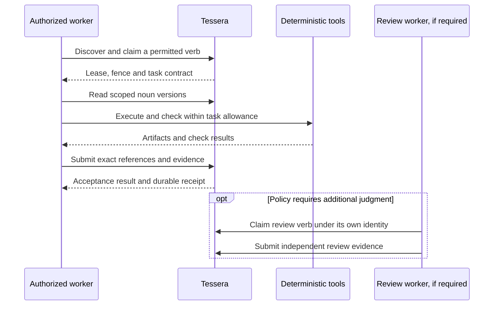

# Architecture

Tessera owns the shared task and artifact lifecycle. Product repositories add domain behavior or tools around that fabric. The live home portal helps people and agents discover the right entry point. Agora documents those relationships.

## Nouns and verbs

| Concept | Meaning | Examples |
| --- | --- | --- |
| Noun | A scoped, versioned input, definition, artifact or observation | A synthetic evidence bundle, recipe, task contract, test result or execution report |
| Verb | An independently schedulable outcome with a claimant, lease and acceptance contract | Analyze a bundle, draft a kit, verify a recipe or review a proposed artifact |
| Deterministic operation | An operation performed within a verb or by the coordination service | Check a permission, heartbeat a lease, compare versions, calculate a fee or validate a schema |

This is the organizing model. It does not require a separate task for every read or arithmetic operation. Split a verb when work has an independent result, different permissions, separate equipment or a useful recovery boundary.

Workers should receive a small contract with relevant noun references, required outcomes, acceptance checks and resource limits. Required procedures, preferred methods, optional references and requested discovery have different force. A suggested tool does not grant permission to use it. Retrieved content cannot change the worker's authority.

The full policy and examples live with [Tessera](https://github.com/ta-amps/tessera/blob/main/docs/WORKER-FIRST-EXECUTION.md). It is a design and migration requirement; universal coverage across every endpoint has not been measured.

## Work and storage authority

Tessera supplies authenticated scope, queue permissions, claims, fencing tokens, heartbeats, task dependencies, compare-and-set records, content-addressed blobs, named buckets and durable receipts. Its HTTP, MCP, CLI and web interfaces expose the owning contracts. A frontend or shim cannot grant broader authority.

Shamash and Eranos use Tessera for staged work and artifacts. Herma can read permitted context and expose explicitly requested model interfaces. The Python dependencies of all three pin a tested, merged Tessera revision. Kothar and Kinema provide deterministic tools a worker can invoke while holding a verb. The worker stores outputs using its own authorized fabric interface; a tool result does not become a shared noun or published artifact by itself.

Execution observations are protected nouns associated with accepted completion. They retain server-observed task and lease facts separately from optional worker-reported telemetry. Bounded recall can return permitted prior evidence. Recall does not authorize automatic replay, establish correctness or grant a new effect. See [execution reports and recall](https://github.com/ta-amps/tessera/blob/main/docs/execution-memory.md).

## Reasoning and review

Workers perform ordinary reasoning, repair and self-checks. Deterministic server gates validate identity, types, versions, leases and receipts. Product policies still apply: Eranos requires a different reviewer from the drafter, Shamash keeps T3/T4 decisions human-only, and shared generated-artifact admission requires independent evidence and review.

A worker may run on a contributor's machine, in an approved cloud service or in an operator environment. Placement does not establish who pays, whether the work is private or which actions are allowed. Private work uses authenticated ownership, queue scope, storage restrictions and effect limits. A `private` tag grants nothing.

## Explicit model interfaces and exceptions

Herma supports caller-configured routing and explicit typed conversations. A configured optional shim may routinely use a model for interpretation within its own scope and budget. This does not insert a paid reviewer into every task or turn.

Direct server-initiated inference needs a recorded purpose, responsible principal, permitted data, provider policy, allowance, deadline, retry limit and outcome. Prefer an authorized worker when the work can wait. Missing capacity or an invalid payload should leave work pending, parked or rejected with an actionable error.

Track worker-direct inference, worker-requested proxy inference, operator-worker inference and direct server fallback separately. These are accounting distinctions, not new wire fields. The October 29 native tests used 30 worker inference requests and zero deployed-server model requests; they do not establish the lifetime usage of the ecosystem.

## Frontier and contribution packs

The existing Frontier portal uses Tessera's namespace, nouns, tasks and admission boundaries. Its scheduled discovery can leave repair work for external workers. Live server repair is off. Scheduled discovery does not edit repositories or qualify generated candidates for publication.

Frontier's intended packaging is a declarative seed/contract pack. `pack-contributions` describes ten proposed meta-pack workflows and synthetic examples; it contains no importer or active learning service. General pinned category/profile resolution and general rule activation/rollback still require implementation and verification.

Keep category membership, search ranking, execution composition and access control distinct. A category match can help find a noun; it cannot activate a tool, admit a candidate or widen permissions.
