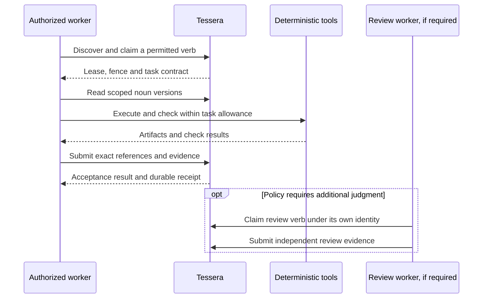

# Architecture

Only nouns, verbs, surfaces and narrow supporting infrastructure. Seed packs
contain nouns and verbs. Nouns hold reusable knowledge,
tools, models, recipes and artifacts. Verbs describe independently schedulable
outcomes for authorized workers. Tessera owns the shared task and artifact
lifecycle. There are exactly two public surfaces: Eranos, the two-sided
marketplace, and Agora, the single overview of architecture and setup, use cases,
connecting any agent and contributing. Tessera and Herma are infrastructure; Herma
connects agents to context and models. Home is not a surface; its address will
send people to Agora. Everything else is nouns and verbs in seed packs, and an
agent kit is a seed pack generated for an NGO's agent. Follow the
[required checkpoint](architecture-checkpoint.md).

## Nouns, verbs and their surfaces

| Concept | Meaning | Examples |
| --- | --- | --- |
| Noun | A scoped, versioned input, definition, artifact or observation | A synthetic evidence bundle, recipe, task contract, test result, execution report or an agent's whole setup |
| Verb | An independently schedulable outcome with a claimant, lease and acceptance contract | Analyze a bundle, draft a kit, verify a recipe or review a proposed artifact |
| Surface | Where people and agents come in; there are exactly two public surfaces | Eranos, the two-sided marketplace, and Agora, the single overview |
| Infrastructure | Narrow supporting coordination, management and connections | Tessera (identity, storage, leases, CAS, transport and backpressure) and Herma (context and models) |

Seed packs bundle nouns and verb templates/seeds. They are not an additional
primitive, autonomous runtime or activation authority. Deterministic operations
can remain within a verb or infrastructure; they need not each become a task.

Project names are labels, not primitives. Descriptions use existing noun records,
namespace and permission mechanisms. The
public grouping introduces no additional scheduler or storage authority.

This is the organizing model. It does not require a separate task for every read or arithmetic operation. Split a verb when work has an independent result, different permissions, separate equipment or a useful recovery boundary.

Workers should receive a small contract with relevant noun references, required outcomes, acceptance checks and resource limits. Required procedures, preferred methods, optional references and requested discovery have different force. A suggested tool does not grant permission to use it. Retrieved content cannot change the worker's authority.

Several attempt verbs may reference the same brief noun when independent
solutions are useful. Separate leases, output keys and receipts preserve each
contribution. Comparison and remixing are later verbs; the queue need not force
one creative answer per input.

The full policy and examples live with [Tessera](https://github.com/ta-amps/tessera/blob/main/docs/WORKER-FIRST-EXECUTION.md). It is a design and migration requirement; universal coverage across every endpoint has not been measured.

## Work and storage authority

Tessera supplies authenticated scope, queue permissions, claims, fencing tokens, heartbeats, task dependencies, compare-and-set records, content-addressed blobs, named buckets and durable receipts. Its HTTP, MCP, CLI and web interfaces expose the owning contracts. A frontend or shim cannot grant broader authority.

Eranos uses Tessera for staged work and artifacts. Herma can read permitted context and expose explicitly requested model interfaces. The Python dependencies of both pin a tested, merged Tessera revision. The pack library distributes seed packs: versioned code references, recipes and deterministic tools a worker can invoke while holding a verb, such as the collections for composing verified code without rewriting it and for video and motion made with code. A pack has no surface or brand name of its own; the older pack websites will retire behind archive notices. The worker stores outputs using its own authorized fabric interface; exporting a pack or producing a tool result does not install, activate or admit an artifact by itself.

Execution observations are protected nouns associated with accepted completion. They retain server-observed task and lease facts separately from optional worker-reported telemetry. Bounded recall can return permitted prior evidence. Recall does not authorize automatic replay, establish correctness or grant a new effect. See [execution reports and recall](https://github.com/ta-amps/tessera/blob/main/docs/execution-memory.md).

## Reasoning and review

Workers perform ordinary reasoning, repair and self-checks. Deterministic server gates validate identity, types, versions, leases and receipts. Product policies still apply: Eranos requires a different reviewer from the drafter, the pack for spotting exploitation and scams leaves every hold and referral to a person, and shared generated-artifact admission requires independent evidence and review.

A worker may run on a contributor's machine, in an approved cloud service or in an operator environment. Placement does not establish who pays, whether the work is private or which actions are allowed. Private work uses authenticated ownership, queue scope, storage restrictions and effect limits. A `private` tag grants nothing.

## Explicit model interfaces and exceptions

Server configuration, provider plans, health observations and attempt evidence
are nouns too. Independently schedulable server management is private verb work.
Server-side placement does not exempt either from scoped access or attribution.
Surfaces cannot expose management nouns, history, logs or claims merely because
they share an infrastructure operator. Provider and model selection must remain
within the caller's permitted data destinations and payer allowance.

Deterministic infrastructure and essential management services stay server-side
when they own identity, storage, leases, accounting, authorized provisioning,
scheduling or recovery. They retain effect authority and audit requirements.
Calling a domain agent “management” does not exempt it from the worker rule.

Herma supports caller-configured routing and explicit typed conversations. A configured optional shim may routinely use a model for interpretation within its own scope and budget. This does not insert a paid reviewer into every task or turn.

Direct server-initiated inference needs a recorded purpose, responsible principal, permitted data, provider policy, allowance, deadline, retry limit and outcome. Prefer an authorized worker when the work can wait. Missing capacity or an invalid payload should leave work pending, parked or rejected with an actionable error.

Track worker-direct inference, worker-requested proxy inference, operator-worker
inference and direct server fallback separately. These are accounting
distinctions, not new wire fields. The [dated evidence](status.md) reports usage
by experiment; it does not establish the lifetime usage of the ecosystem.

Preserve the caller's supported model and harness generation settings. The
native test transport no longer injects a response-token ceiling. Test or task
spending belongs in an explicit run allowance, with failures reported clearly.
An arbitrary truncation is not evidence that a worker cannot solve its task.

New work is paced from observed service pressure. Adaptive claim admission
queues bursts and adjusts concurrency while lease maintenance continues.
Configured pending-work and wait bounds protect resources; they do not establish
a fixed claims-per-minute quota or a measured capacity guarantee.

## Frontier and contribution packs

Frontier's existing discovery work, shown on the home portal until that address sends people to Agora, uses Tessera's namespace, nouns, tasks and admission boundaries. Its scheduled discovery can leave repair work for external workers. Live server repair is off. Scheduled discovery does not edit repositories or qualify generated candidates for publication.

Frontier's intended packaging is a declarative seed/contract pack. `pack-contributions` describes ten proposed meta-pack workflows and synthetic examples; it contains no importer or active learning service. General pinned category/profile resolution and general rule activation/rollback still require implementation and verification.

Keep category membership, search ranking, execution composition and access control distinct. A category match can help find a noun; it cannot activate a tool, admit a candidate or widen permissions.
