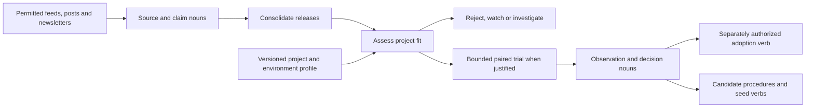

# Research for your projects

The goal is to reduce the work between seeing a new idea and deciding whether it belongs in a project. A thousand posts may repeat a few releases, and their benchmark numbers may describe different hardware, tasks and quality requirements. Reading every summary still leaves the comparison work undone.

The proposed [capability research seed workflow](https://github.com/ta-amps/pack-contributions/blob/main/docs/capability-research.md) turns that stream into a small set of decisions against a versioned project profile. It covers memory systems, agent harnesses, model nodes, decision systems, 3D tools and motion workflows without assuming one benchmark can rank them all.

Workers preserve source provenance, distinguish reported claims from reproduced results, and stop early when a candidate fails a hard requirement. A target profile records architecture, interfaces, actual hardware, memory limits, privacy requirements, provider and license constraints, budgets and ranked preferences. Unknown requirements stay explicit.

The comparison contract pins the current baseline, candidate versions, relevant tasks and measurement conditions before a trial. Incompatible leaderboards remain non-comparable. A local experiment records quality, failures, latency, resource usage and adoption effort where they matter. It can conclude that the current implementation should stay.

The report starts with the few decisions that could change current work, each with evidence, tradeoffs, uncertainty and a next action or recheck trigger. Detailed observations remain linked nouns. Duplicate announcements should reuse a valid decision; changed versions or project constraints can reopen it.

Research verbs can also produce reusable nouns: a capability description, a benchmark contract, a fixture generator, an adapter proposal or a research procedure. A later verb can use those pinned outputs. Their creation does not automatically admit executable code, activate a shim or authorize adoption.

Tessera supplies scoped work, evidence and receipts. Authorized workers perform the research and trials. Herma can provide optional context. Kothar and Kinema can supply relevant deterministic tools where an implementation exists. The contribution repository holds the proposed pack instructions, and Agora explains where the workflow fits.

The [research seed authoring tool](https://github.com/ta-amps/tessera/blob/main/docs/research-seeds.md) now constructs pinned noun inputs and private worker tasks for source discovery, collector construction, schedule proposals and scans. Its default preview is offline; explicit enqueue uses an existing scoped queue. These authoring stages passed their tests. They do not establish a running collector or scheduler.

No LinkedIn, X or inbox collector, research schedule, general comparison engine or automatic adoption service was enabled. The first useful pilot needs one project profile, one capability family, a small permitted source batch and a trial allowance. The [seed operations guide](https://github.com/ta-amps/pack-contributions/blob/main/docs/seed-operations.md) describes mailbox and scheduling work; no mailbox account or newsletter subscription has been created by this release.
