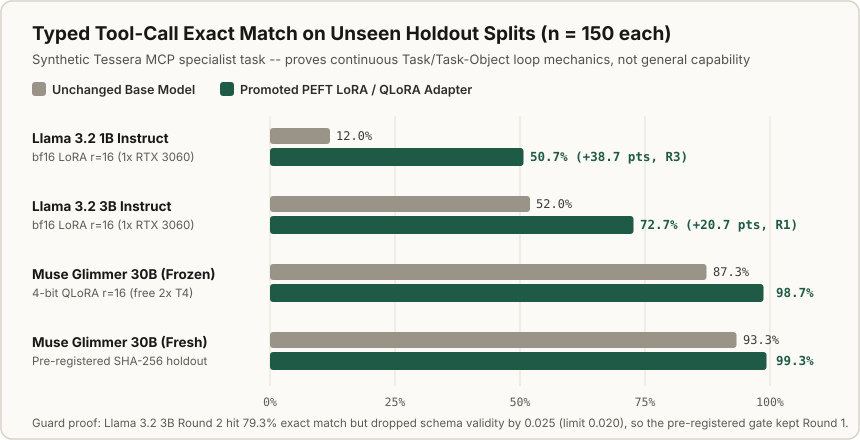
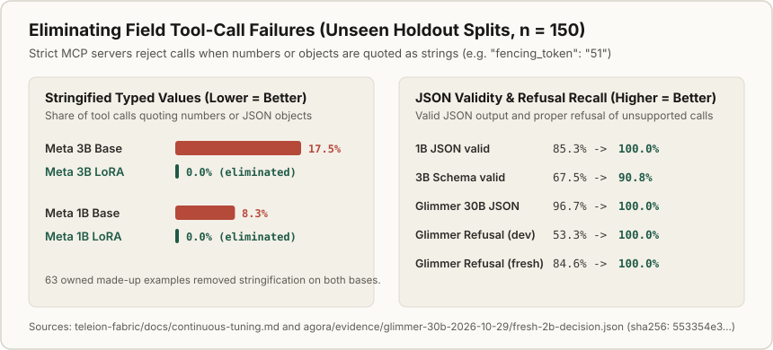

# Pre-Registered Evaluation & Promotion Gate Benchmarks

Every model-tuning round in `ta-amps` is scored by a deterministic evaluation Task (`verb.benchmark_harness`) and gated by a pre-registered promotion rule task object (`tool-call-specialist.promotion` v1, `sha256: bf0fa821717c2400faab77652f067ea85f2616eea329c6e139af33a423e4b3b7`) fixed before training runs.

> **What these benchmarks show -- and what they do not:** All splits evaluate one narrow, made-up task (producing schema-valid Teleion Fabric MCP JSON tool calls or exact refusal reasons on unseen tool families). They prove that the continuous Task and task-object learning loop measures real specialist gains, blocks contaminated rows, and rejects regressions; they are not general LLM capability benchmarks.

## Holdout Exact-Match Accuracy

| Base Model | Tuning Method | Split (`n = 150`) | Base | Tuned | Paired Delta & Gate Outcome |
| --- | --- | --- | --- | --- | --- |
| **Muse Glimmer 30B** | 4-bit `bitsandbytes` QLoRA (`2x T4`) | Pre-registered fresh holdout | `93.3%` | **`99.3%`** | `+6.0%` (`95% CI [+2.0%, +10.7%]`), **12/12 checks passed** |
| **Muse Glimmer 30B** | 4-bit `bitsandbytes` QLoRA (`2x T4`) | Frozen unseen-family test | `87.3%` | **`98.7%`** | `+11.3%` (`95% CI [+5.3%, +18.0%]`), 8/8 reload match |
| **Meta's open-weight 3B model** | bf16 `peft` LoRA (`1x RTX 3060`) | Frozen unseen-family test | `52.0%` | **`72.7%`** | `+20.7%` (`95% CI [+12.0%, +29.3%]`), Round 1 promoted |
| **Meta's open-weight 3B model** | bf16 `peft` LoRA (`1x RTX 3060`) | Round 2 candidate (rejected) | `72.7%` (champ) | `79.3%` | **Rejected by gate:** schema validity fell `0.025` (limit `0.020`) |
| **Meta's open-weight 1B model** | bf16 `peft` LoRA (`1x RTX 3060`) | Frozen unseen-family test | `12.0%` | **`50.7%`** | `+38.7%` cumulative by Round 3; Round 4 rejected on schema drop |

**Which base models?** "Meta's open-weight 1B model" and "Meta's open-weight 3B model" are Meta's instruct checkpoints with about 1 billion and 3 billion parameters, used here as bases for tool-call tuning and specialist adapters. The tuning recipes use `bf16` with no quantization and `131,072` context tokens. The LoRA settings are `r=16, alpha=32` on seven projection modules, with `11.3M` (1B) and `24.3M` (3B) trainable params; the 3B swarm run used `fp16` on Kaggle. The exact 3B checkpoint id is in the [deployment guide](https://github.com/ta-amps/teleionlabs-teleion-fabric/blob/main/docs/deployment-guide.md#L108), and both recipes, with both ids, are at [this pinned commit](https://github.com/ta-amps/teleion-fabric-infrastructure-work-and-storage-engine/tree/0d7052cdfa2fdb13d9eb433e8b3038fd6599d4da/examples/continuous_tuning/recipes).

## Field Failure Elimination (Stringified Values, Schema & JSON Validity)

## Three Anti-Cheating Guarantees

1. **Disjoint Tool Families & Three-Fingerprint De-duplication:** Training prompts only ever expose `lease`, `verb discovery`, `records`, and `access` tools. Frozen test and fresh holdouts test unseen `buckets` and `feeds` families. Curation hashes exact text, normalized request, and slot-masked template shape so zero evaluation shapes leak into training.
2. **Pre-Registered SHA-256 Fresh Holdouts:** For Muse Glimmer 30B, the 150-row fresh holdout digest (`0ce30e9ff593a4e7238012236e38368c219fc235284d03e1fb898d728c196d56`) was recorded before any model scored it.
3. **Negative Results Caught by the Gate:** On both Meta's open-weight 1B model (Round 2 and Round 4) and Meta's open-weight 3B model (Round 2, despite `79.3%` exact match), candidates that hurt schema validity or failed to clear paired bootstrap bounds were automatically kept out by `decide_promotion`.

## Raw Records & Reproducible Verifiers

- **Muse Glimmer 30B Evidence Bundle:** [`../evidence/glimmer-30b-2026-10-29/README.md`](../evidence/glimmer-30b-2026-10-29/README.md)
- **Evidence JSONs for Meta's open-weight 1B and 3B models:** [Fabric repository, pinned commit](https://github.com/ta-amps/teleion-fabric-infrastructure-work-and-storage-engine/tree/0d7052cdfa2fdb13d9eb433e8b3038fd6599d4da/examples/continuous_tuning/evidence)
- **Adapter Configs & Source Digests:** [`../training/README.md`](../training/README.md)
