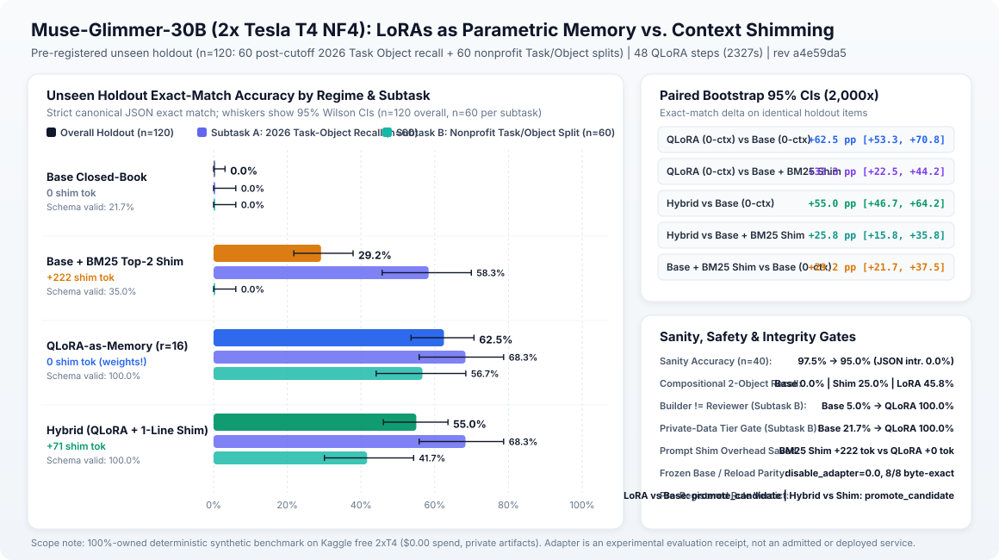

# Muse Glimmer 30B tuned as LoRA-as-Memory & Task-Object Specialist (October 31, 2026)

This directory contains the reproducible SHA-256 receipts, raw model generations, GPU telemetry, and verification outputs for the second measured **Muse Glimmer 30B** fine-tuning run on free Kaggle `2x NVIDIA Tesla T4` GPUs (`$0.00` spend): **LoRA-as-Memory (`lora-memory-v1`)**.

- **How it was made:** trained on `2x Tesla T4` (`16 GB` each, `fp16` sharded across `cuda:0` and `cuda:1` at layer 24 with vision tower dropped, peak VRAM `10,505 MiB` / `11,619 MiB`) using `peft` LoRA (`r=16, alpha=32, dropout=0.05`, `95,846,400` trainable params across `364` linear projections, `48` steps in `2,327.1s`) strictly on owned deterministic synthetic MIT templates (`320` train rows).
- **What it measures:** a pre-registered `120`-row unseen holdout (`sha256: a5f59267b0d62e65c04242f81d829068e567d6a92229a2ab8f9c493062f9cbc2`) comparing 4 regimes:
  1. **Base Closed-Book (`0` shim tokens)**
  2. **Base + BM25 Top-2 Context Shim (`+222.3` shim tokens/call)**
  3. **LoRA-as-Memory (`0` shim tokens, weights only)**
  4. **Hybrid (`LoRA + 71.1-token 1-line pointer shim`)**
- **What it is not:** nothing was promoted to a hosted production endpoint, no Muse API outputs or nonprofit data entered training, and derived `.safetensors` weights (`383,494,648` bytes, `sha256: 09f14d81fcf8f61f6902f33ec1e3ad607da5c8137ab122de4c25a2d1e8d7d42f`) remain private under base model terms.

## Measured Results (`n = 120` Pre-Registered Unseen Holdout)

| Regime | Avg Shim Tokens | Overall Strict Exact Match | Subtask A: Post-Cutoff Recall (`n=60`) | Compositional 2-Object (`n=24`) | Subtask B: NGO Intake Split (`n=60`) | Valid JSON / Schema | Median Latency (`p50`) |
| --- | --- | --- | --- | --- | --- | --- | --- |
| **Base Closed-Book** | `0.0` | `0.0%` (`0/120`) | `0.0%` (`0.0%` Object-ID F1) | `0.0%` | `0.0%` (`0.0%` Task-Object F1) | `59.2%` / `21.7%` | `18.07s` |
| **Base + BM25 Top-2 Shim** | `222.3` | `29.2%` (`35/120`) | `58.3%` (`70.8%` Object-ID F1) | `25.0%` | `0.0%` (`0.0%` Task-Object F1) | `80.0%` / `60.0%` | `19.75s` |
| **LoRA-as-Memory (`r=16`, weights only)** | **`0.0`** | **`62.5%`** (`75/120`) | **`68.3%`** (`86.9%` Object-ID F1) | **`45.8%`** | **`56.7%`** (**`98.1%`** Task-Object F1) | **`100.0%` / `100.0%`** | **`8.67s` (`2.28x` faster)** |
| **Hybrid (`LoRA + 1-line pointer`)** | `71.1` | `55.0%` (`66/120`) | `60.0%` (**`94.4%`** Object-ID F1) | **`50.0%`** | `50.0%` (`97.9%` Task-Object F1) | **`100.0%` / `100.0%`** | `10.17s` |

### Paired Bootstrap Intervals & Integrity Gates

- **LoRA-as-Memory vs. Base Closed-Book (`0` shim tokens):** `+62.5` percentage points, 2,000-resample paired bootstrap 95% CI `[+53.3, +70.8]` pp (`75` improved, `0` regressed).
- **LoRA-as-Memory (`0` shim tokens) vs. Base + BM25 Top-2 Shim (`222.3` shim tokens):** **`+33.3` percentage points**, 95% CI `[+22.5, +44.2]` pp (`45` improved, `5` regressed), while cutting median per-row latency from `19.75s` to `8.67s`.
- **Governance & Safety Invariants on Unseen NGO Intakes (`n=60`):** LoRA-as-Memory achieved **`100.0%`** separation of `builder_principal != reviewer_principal` and **`100.0%`** contributor-tier refusal (`contributor_tier_allowed: false`) on private-data scenarios.
- **General-Capability Sanity (`n=40`) & Fresh Reload Parity:** Sanity exact match `97.5% -> 95.0%` (`0.0%` JSON intrusion on plain-text questions); fresh base reload verified `disabled_vs_base_max_abs = 0.0`, `reloaded_vs_tuned_max_abs = 0.0`, and `8/8` byte-identical greedy regenerations; pre-registered `promotion.decide()` (`bf0fa821717c2400...`) returned `promote_candidate`.

## Sanitization Note

In `results.json` and `preregistered-holdout-receipt.json`, local workstation directory prefixes and the private Kaggle account slug are replaced with `<workspace>/` and `<kaggle-user>` for public release. Both the raw worker `results.json` digest (`440cb5cabd77e615744119737b2ae82d0fc0fc97da1a26446b621a5e0e210f28`) and the sanitized `results.json` digest are recorded in `verification_receipt.json`.
