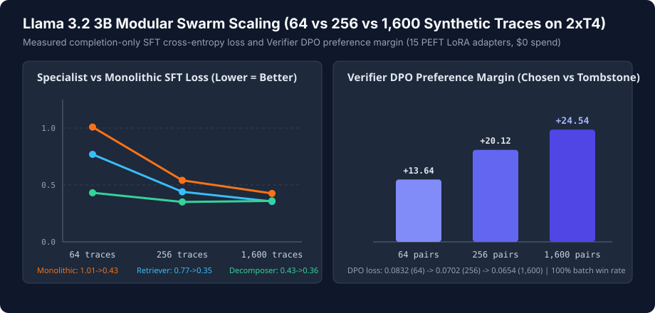
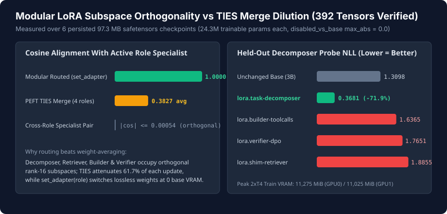

# Llama 3.2 3B Modular Multi-LoRA Swarm & Scaling Receipts (October 31, 2026)

This bundle contains the SHA-256-verified training manifests, telemetry, and `.safetensors` subspace orthogonality analysis harvested from the private Kaggle `2x NVIDIA Tesla T4` run (`glimmer-modular-llama32-swarm`, `9,845.2s`, `$0.00` spend) over synthetic 256-worker OpenCode/MCP swarm traces (`64`, `256`, and `1,600` trace scales).

## Scope & Honesty Boundary

- **100% synthetic MIT data:** Every training and preference pair comes from owned synthetic MIT task generators (`0` overlap against the 200-row holdout; zero Muse API completions, nonprofit files, or private traces). Llama 3.2 weights and derived adapters remain private under the Llama 3.2 Community License (*Built with Llama*).
- **What completed and is verified byte-for-byte (`32` harvested files):**
  1. Official `Llama-3.2-3B-Instruct` config (`39fb36dc...`) & tokenizer (`bbc1904d...`) verification (`Stage 2: ok`).
  2. Parallel dual-GPU training (`Stage 3: ok`, `8,703.08s`, peak VRAM `11,275 MiB` GPU 0 / `11,025 MiB` GPU 1) across **all 15 PEFT LoRA / SFT+DPO jobs** (`r=16, alpha=32`, `24,313,856` trainable params, `392` `F32` tensors each), with `max_abs_diff_disabled_vs_base == 0.0` across all 15 adapters.
  3. Fresh-base co-resident multi-LoRA attachment plus PEFT Linear (`lora.merged-linear-1600`) and TIES (`lora.merged-ties-1600`) composition (`17` total manifests + `6` persisted `97,307,544`-byte `.safetensors` checkpoints verified byte-exact on CPU with `0` NaN/Inf).
- **What failed and is NOT claimed:** During `Stage 4` (`parallel_eval_and_composition`), after saving `lora.merged-linear-1600` and `lora.merged-ties-1600`, batched greedy decoding (`batch_size = 13..25`, `max_new_tokens = 1,472`) hit `torch.OutOfMemoryError` on the `14.56 GiB` T4 (`9,845.2s`). No batched greedy holdout exact-match score is claimed from this 15-adapter matrix run (exact-match holdout benchmarks for Llama 3.2 1B/3B reference `tessera/docs/continuous-tuning.md`).

## Measured Scaling, DPO Margin & Subspace Orthogonality

| Specialist Adapter (`r=16`) | `64` Traces | `256` Traces | `1,600` Traces | Key Invariant Verified |
| --- | --- | --- | --- | --- |
| `lora.task-decomposer` (SFT loss) | `0.4313` | `0.3507` | **`0.3600`** | Held-out decomposer probe NLL `1.3098 -> 0.3681` (`-71.9%`) |
| `lora.shim-retriever` (SFT loss) | `0.7687` | `0.4398` | **`0.3549`** | `-74.8%` completion cross-entropy reduction from `1.4086` |
| `lora.builder-toolcalls` (SFT loss) | `0.7460` | `0.6210` | **`0.6659`** | `disabled_vs_base_max_abs == 0.0` |
| `lora.verifier-dpo` (DPO loss / margin) | `0.0832` / `+13.64` | `0.0702` / `+20.12` | **`0.0654` / `+24.54`** | `100.0%` batch win rate on chosen vs tombstone pairs |
| `lora.monolithic-mixed` (SFT loss) | `1.0088` | `0.5407` | `0.4256` | Trained on pooled 4-role mixture |

- **Near-exact specialist subspace orthogonality (`392` `F32` tensors):** Across `24.3M` LoRA parameters, pairwise cosine similarity between `decomposer_1600`, `retriever_1600`, `builder_1600`, and `verifier_1600` satisfies `|cos| <= 0.00054`. Consequently, static TIES merging (`merged_ties_1600`) dilutes cosine alignment with each active specialist to `0.377..0.388`, whereas dynamic `set_adapter(role)` routing preserves `1.000` specialist fidelity with zero extra base-model VRAM.
- **Sanitization note:** Local workstation paths and the private Kaggle account handle in `results.json` and `adapter_manifests/*.json` were replaced with `<workspace>/` and `<kaggle-user>`. Raw worker `results.json` SHA-256 (`2cf98aa74557afe3689ee1255f50e2ff8d65093f09550c409ab827ca2e11016b`) is recorded in `EVIDENCE_MANIFEST.json`.
